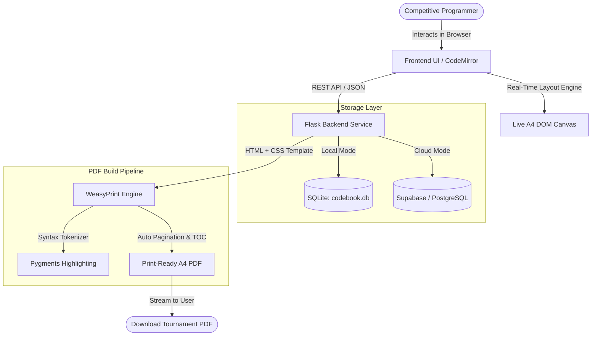

<div align="center">

# ⚡ Codebook Studio

**High-Density, Tournament-Compliant ICPC Reference Notebook Compiler**

*Design, organize, and compile world-class algorithmic libraries into clean, print-ready A4 team notebooks with real-time live preview.*

[](https://www.python.org/)
[](https://flask.palletsprojects.com/)
[](https://weasyprint.org/)
[](https://www.docker.com/)
[](LICENSE)

<br/>

[✨ Key Features](#-key-features) • [🚀 Quick Start](#-quick-start) • [🐳 Docker Setup](#-docker-setup) • [🎨 Cover Themes](#-cover-themes) • [📐 Architecture](#-system-architecture) • [⚙️ Configuration](#-configuration)

<br/>

</div>

---

## 🌟 Overview

**Codebook Studio** is a modern, full-featured web application engineered specifically for competitive programmers preparing for **ICPC Regionals, World Finals, NCPC, and national Olympiads**.

Unlike static LaTeX scripts that require tedious local compiling and manual layout debugging, Codebook Studio provides an **instant, split-pane interactive environment**: edit your code snippets, metadata, and styles on the left, and watch the exact A4 tournament document paginate in real-time on the right.

```
┌─────────────────────────────────┬──────────────────────────────────────────┐
│  🛠️ SIDEBAR CONTROLS             │  📄 REAL-TIME A4 LIVE PREVIEW            │
│  ├─ Team & University Meta      │  ┌────────────────────────────────────┐  │
│  ├─ Cover Theme & Accent Color  │  │ [Cover] Codebook Studio            │  │
│  ├─ Multi-Column Density (2/3)  │  │ Team: Legendary Grandmasters       │  │
│  ├─ Algorithm Library (Topics)  │  ├────────────────────────────────────┤  │
│  └─ Starter Pack & Cloud Sync   │  │ [TOC] Auto-generated Index & Pages │  │
│                                 │  ├────────────────────────────────────┤  │
│  [ 🚀 Download Print-Ready PDF] │  │ [Col 1] Segment Tree [Col 2] Dinic │  │
└─────────────────────────────────┴──────────────────────────────────────────┘
```

---

## ✨ Key Features

<table>
  <tr>
    <td width="50%">
      <h3>⚡ Real-Time Live Preview</h3>
      Pixel-perfect A4 canvas that calculates text wrapping, margins, and column layouts instantly in your browser before you compile.
    </td>
    <td width="50%">
      <h3>📄 Tournament-Grade Pagination</h3>
      High-density <b>2-column</b> or <b>3-column</b> layouts engineered to maximize algorithm count while strictly honoring competition page limits (e.g. ICPC 25-page limit).
    </td>
  </tr>
  <tr>
    <td width="50%">
      <h3>🎨 5 Designer Cover Themes</h3>
      Choose between <b>Terminal</b> (macOS crisp light-theme window), <b>Editorial Sketch</b>, <b>Geometric</b>, <b>Banner</b>, and <b>Minimal</b> — optimized for clean, low-ink paper printing.
    </td>
    <td width="50%">
      <h3>📚 Preloaded Starter Pack</h3>
      One-click import of tournament-essential algorithms across <i>Data Structures, Graphs, Math & Number Theory, Dynamic Programming, Geometry,</i> and <i>Strings</i>.
    </td>
  </tr>
  <tr>
    <td width="50%">
      <h3>🔒 Cloud Sync & Zero-Login Mode</h3>
      Use instantly without friction as a local guest, or sign up with <b>GitHub / Google OAuth</b> to access and synchronize your notebooks from anywhere.
    </td>
    <td width="50%">
      <h3>🖨️ WeasyPrint PDF Engine</h3>
      Generates vector-crisp, syntax-highlighted (CodeMirror/Prism/Pygments) PDFs with automated Table of Contents and running headers/footers.
    </td>
  </tr>
</table>

---

## 🎨 Cover Themes

Codebook Studio comes with 5 curated cover themes designed for aesthetic appeal and paper-saving efficiency:

| Theme | Preview Style | Best For |
|:---|:---|:---|
| **Terminal (Light)** | macOS light window with bash prompts (`whoami`, `./verify_build.sh`) | Modern hacker aesthetic, ink-efficient white canvas |
| **Minimal** | Clean typography, subtle rules, and balanced whitespace | Pure, distraction-free corporate / academic look |
| **Editorial Sketch** | Technical notebook style with hand-crafted accents | Distinctive engineering laboratory feel |
| **Geometric** | Diagonal corner badge with solid accent lines | High-energy dynamic presentation |
| **Banner** | Full-width bold accent header with inverse typography | High-contrast team identity |

---

## 🚀 Quick Start

Choose your preferred setup method below:

<details open>
<summary><b>Method 1: One-Click Launchers (Zero Manual Commands)</b></summary>
<br/>

The repository includes pre-configured launch scripts that automatically detect missing dependencies, install them, and open your browser:

- **Windows**: Double-click [`start.bat`](file:///t:/Project/Codebook%20Builder/start.bat)
- **Linux**: Run `./start.sh`
- **macOS**: Double-click or run `./start.command`

</details>

<details>
<summary><b>Method 2: Manual Python Setup</b></summary>
<br/>

1. **Clone the repository**:
   ```bash
   git clone https://github.com/abokash590/Codebook-Studio.git
   cd Codebook-Studio
   ```

2. **Create and activate a virtual environment**:
   ```bash
   python -m venv venv
   # On Windows:
   venv\Scripts\activate
   # On Linux / macOS:
   source venv/bin/activate
   ```

3. **Install dependencies**:
   ```bash
   pip install -r requirements.txt
   ```

4. **Install Fonts & Runtime Dependencies**:
   - **Fonts**: [JetBrains Mono](https://www.jetbrains.com/lp/mono/) and [Inter](https://rsms.me/inter/)
   - **Windows Only**: WeasyPrint requires the GTK3 runtime. Download and run the [GTK3 for Windows Installer](https://github.com/tschoonj/GTK-for-Windows-Runtime-Environment-Installer/releases) (ensure *"Set up PATH"* is checked).
   - **Ubuntu/Debian**:
     ```bash
     sudo apt-get update && sudo apt-get install -y libpango-1.0-0 libpangocairo-1.0-0 fonts-jetbrains-mono fonts-inter
     ```
   - **macOS**:
     ```bash
     brew install pango font-jetbrains-mono font-inter
     ```

5. **Start the application**:
   ```bash
   python app.py
   ```
   Open **http://127.0.0.1:5050** in your browser.

</details>

<details>
<summary><b>Method 3: Docker Deployment (Recommended for Cloud / Server)</b></summary>
<br/>

The bundled [`Dockerfile`](file:///t:/Project/Codebook%20Builder/Dockerfile) bundles headless Chromium, Cairo, Pango, WeasyPrint, and all required fonts out of the box with zero host configuration required:

```bash
# Build the Docker image
docker build -t codebook-studio .

# Run the container
docker run -p 5050:5050 -v $(pwd)/backend/data:/app/backend/data codebook-studio
```

Then visit **http://localhost:5050**.

</details>

---

## 📐 System Architecture

The following diagram illustrates how Codebook Studio renders live browser previews and compiles tournament-grade PDFs:



---

## ⚙️ Configuration

Copy `.env.example` to `.env` to configure your environment:

```bash
cp .env.example .env
```

| Variable | Description | Default / Example |
|:---|:---|:---|
| `SECRET_KEY` | Flask session cryptographic key | `your_super_secret_key` |
| `DATABASE_URL` | Cloud database URL (PostgreSQL / Supabase / Neon) | *(Empty for local SQLite)* |
| `GITHUB_CLIENT_ID` | GitHub OAuth application Client ID | *(Optional)* |
| `GITHUB_CLIENT_SECRET` | GitHub OAuth application Client Secret | *(Optional)* |
| `GOOGLE_CLIENT_ID` | Google Cloud OAuth Client ID | *(Optional)* |
| `GOOGLE_CLIENT_SECRET`| Google Cloud OAuth Client Secret | *(Optional)* |
| `PORT` | Web server listening port | `5050` |

---

## 💡 ICPC Codebook Best Practices

> [!TIP]
> **Page Budgeting Strategy**
> - **2-Column Layout**: Best for readability when templates contain extensive commentary or inline documentation.
> - **3-Column Layout**: Maximum algorithm density. Ideal for packing 80+ algorithms within strict 25-page competition limits.
> - **Font Sizing**: Setting font size to `7.5pt` or `8pt` with `JetBrains Mono` allows long C++ template lines up to 64 characters without clipping.
> - **Boilerplate**: Place your fast I/O, `std::cin` tie macros, and custom hash functions into the dedicated **Boilerplate / Contest Template** section so it appears right after the Table of Contents.

---

## 📁 Project Structure

```
Codebook-Studio/
├── app.py                  # Primary application entry point & auto-browser launcher
├── Dockerfile              # Production-ready container specification with fonts & Cairo
├── requirements.txt        # Python dependency manifest
├── start.bat / start.sh    # Cross-platform one-click launch scripts
├── backend/
│   ├── app.py              # Flask application routes, REST API, & OAuth handlers
│   ├── auth.py             # User authentication, session management, and guest migration
│   ├── db.py               # Database initialization & migrations (SQLite / PostgreSQL)
│   ├── pdf_builder.py      # WeasyPrint PDF compiler, CSS generator, and cover renderer
│   └── data/               # Persistent database storage directory
└── frontend/
    ├── templates/          # Jinja2 templates (index.html)
    └── static/             # Stylesheets (style.css) and client-side logic (app.js)
```

---

## 🤝 Contributing

Contributions, issues, and feature requests are welcome!

1. Fork the repository
2. Create your feature branch (`git checkout -b feature/AmazingFeature`)
3. Commit your changes (`git commit -m "feat: Add AmazingFeature"`)
4. Push to the branch (`git push origin feature/AmazingFeature`)
5. Open a Pull Request

---

## 📜 License

Distributed under the **MIT License**. See `LICENSE` for more information.

<div align="center">
  <sub>Crafted with ❤️ for competitive programmers worldwide.</sub>
</div>
